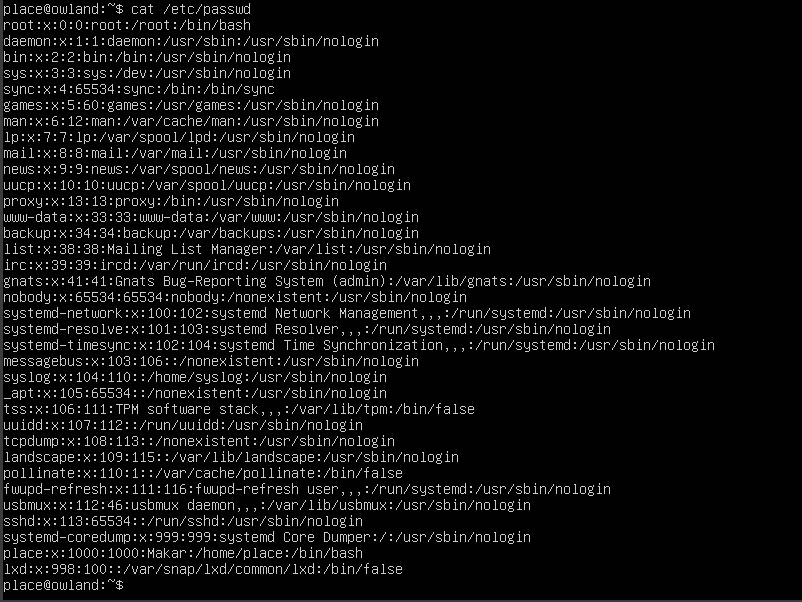

# proj DO1_Linux

## Part 1. Просмотр файла /etc/passwd

-  — вывод команды `cat /etc/passwd`

## Part 2. Создание пользователя

-  — добавление нового пользователя
-  — добавление пользователя в группу
-  — вывод команды `cat /etc/passwd` с новым пользователем

## Part 3. Настройка сети ОС

-  — задание имени машины командой `hostnamectl set-hostname`
-  — установка временной зоны командой `timedatectl set-timezone`
-  — вывод сетевых интерфейсов командой `ip a`. Интерфейс **lo** (loopback) — виртуальный интерфейс с адресом 127.0.0.1, через который компьютер общается сам с собой без выхода в сеть. Используется для тестирования и локального общения приложений.
-  — получение IP от DHCP сервера. DHCP (Dynamic Host Configuration Protocol) — протокол автоматической выдачи сетевых настроек.
-  — получение внутреннего IP шлюза командой `ip route`
-  — получение внешнего IP шлюза через внешний сервис `curl ifconfig.me`
-  — конфигурация статического IP в файле `/etc/netplan/00-installer-config.yaml`
-  — применение настроек командой `netplan apply`
-  — проверка IP после перезагрузки
-  — проверка шлюза после перезагрузки
-  — проверка DNS после перезагрузки
-  — пинг ya.ru, вывод содержит `0% packet loss`
-  — пинг 1.1.1.1, вывод содержит `0% packet loss`

## Part 4. Обновление ОС

-  — вывод команды `sudo apt upgrade` после обновления, сообщение об отсутствии новых обновлений

## Part 5. Использование команды sudo

-  — выдача прав пользователю diman командой `sudo usermod -aG sudo diman`
-  — переключение на пользователя diman и изменение hostname от его имени с использованием sudo
- **sudo** — утилита которая позволяет обычному пользователю выполнять команды с привилегиями суперпользователя (root), не зная его пароля и не входя в систему под ним. Повышает безопасность системы: каждое привилегированное действие требует подтверждения паролем, все действия логируются в `/var/log/auth.log`, а права гибко настраиваются через файл `/etc/sudoers`.

## Part 6. Установка и настройка службы времени

-  — включение NTP синхронизации командой `timedatectl set-ntp on` и проверка статуса службы
-  — вывод команды `timedatectl show`, содержит `NTPSynchronized=yes`

## Part 7. Установка и использование текстовых редакторов

-  — установка редакторов vim, nano, joe

### Создание файлов и сохранение

-  — файл test_vim.txt в редакторе vim. Для сохранения и выхода: Esc, затем `:wq` (w — write, q — quit)
-  — файл test_nano.txt в редакторе nano. Для сохранения: `Ctrl+O`, Enter. Для выхода: `Ctrl+X`
-  — файл test_joe.txt в редакторе joe. Для сохранения и выхода: `Ctrl+K`, затем `X`

### Редактирование без сохранения

-  — редактирование в vim без сохранения. Для выхода: Esc, затем `:q!`
-  — редактирование в nano без сохранения. Для выхода: `Ctrl+X`, затем `N`
-  — редактирование в joe без сохранения. Для выхода: `Ctrl+C`, затем подтвердить отказ

### Поиск и замена

-  — поиск в vim: `/искомое_слово`, следующее вхождение — клавиша `n`
-  — замена в vim: `:%s/старое/новое/g` (% — весь файл, s — substitute, g — все вхождения)
-  — поиск в nano: `Ctrl+W`
-  — замена в nano: `Ctrl+\`, ввести заменяемое слово, затем новое, затем `A` для замены всех вхождений
-  — поиск в joe: `Ctrl+K`, затем `F`
-  — замена в joe: `Ctrl+K`, затем `F`, затем `R`

## Part 8. Установка и базовая настройка сервиса SSHd

-  — установка SSHd командой `sudo apt install openssh-server`
-  — добавление автостарта командой `sudo systemctl enable ssh`
-  — изменение порта на 2022 в файле `/etc/ssh/sshd_config`
-  — вывод команды `ps -aux | grep sshd`, подтверждает наличие процесса sshd
  - `ps` — утилита для просмотра запущенных процессов
  - `-a` — процессы всех пользователей
  - `-u` — подробная информация (пользователь, CPU, память)
  - `-x` — процессы без терминала (фоновые службы и демоны)
  - `| grep sshd` — фильтрация строк содержащих sshd
-  — вывод команды `netstat -tan`, содержит строку `tcp 0 0 0.0.0.0:2022 0.0.0.0:* LISTEN`
  - `-t` — только TCP соединения
  - `-a` — все соединения включая LISTEN
  - `-n` — адреса и порты цифрами
  - **Proto** — протокол (tcp/udp)
  - **Recv-Q** — байты полученные но не обработанные
  - **Send-Q** — байты отправленные но не подтверждённые
  - **Local Address** — адрес и порт на котором слушает служба
  - **Foreign Address** — адрес удалённого подключения
  - **State** — состояние соединения
  - **0.0.0.0** — все сетевые интерфейсы сервера, SSH принимает подключения на любом IP адресе машины

## Part 9. Установка и использование утилит top и htop

-  — установка htop командой `sudo apt install htop`
-  — вывод команды `top`
  - uptime: 1:05
  - количество авторизованных пользователей: 1
  - средняя загрузка системы: 0.00, 0.00, 0.00
  - общее количество процессов: 93
  - загрузка CPU: 0.0 us, 0.3 sy, 99.7 id
  - загрузка памяти: total 1971.6, free 1533.9, used 145.3 MiB
  - PID процесса с максимальным потреблением памяти: 655
-  — вывод top отсортированный по CPU (Shift+P), PID процесса с максимальным потреблением CPU: 10
-  — вывод htop с добавленными метриками Hostname, Clock, Uptime
-  — htop отсортированный по PID (F6)
-  — htop отсортированный по PERCENT_CPU (F6)
-  — htop отсортированный по PERCENT_MEM (F6)
-  — htop отсортированный по TIME (F6)
-  — htop отфильтрованный по процессу sshd (F4)
-  — поиск процесса syslog в htop (F3)

## Part 10. Использование утилиты fdisk

-  — вывод команды `sudo fdisk -l`
  - название диска: /dev/sda
  - размер: 25 GiB
  - количество секторов: 52428800
  - размер swap: 2.0 GiB
-  — вывод команды `swapon --show`, подтверждает размер swap

## Part 11. Использование утилиты df

-  — вывод команды `df`. Единица измерения — килобайты (1K-blocks). Корневой раздел (/):
  - размер: 11758760 KB
  - занятое пространство: 4804324 KB
  - свободное пространство: 6335328 KB
  - процент использования: 44%
-  — вывод команды `df -Th`. Корневой раздел (/):
  - размер: 12G
  - занятое пространство: 4.6G
  - свободное пространство: 6.1G
  - процент использования: 44%
  - тип файловой системы: ext4

## Part 12. Использование утилиты du

-  — вывод базовой команды `du`
-  — размер папки /home в байтах (`sudo du -b /home`)
-  — размер папки /var в байтах (`sudo du -b /var`)
-  — размер папки /var/log в байтах (`sudo du -b /var/log`)
-  — размер папки /home в человекочитаемом виде (`sudo du -sh /home`)
-  — размер папки /var в человекочитаемом виде (`sudo du -sh /var`)
-  — размер папки /var/log в человекочитаемом виде (`sudo du -sh /var/log`)
-  — размер каждого элемента внутри /var/log (`sudo du -h /var/log/*`)

## Part 13. Установка и использование утилиты ncdu

-  — установка ncdu командой `sudo apt install ncdu`
-  — вывод `ncdu /home`
-  — вывод `ncdu /var`
-  — вывод `ncdu /var/log`

## Part 14. Работа с системными журналами

-  — вывод `/var/log/dmesg` — сообщения ядра: загрузка системы, обнаружение оборудования, драйверы
-  — вывод `/var/log/syslog` — все системные события: запуск служб, ошибки, предупреждения
-  — поиск последней авторизации командой `sudo grep "LOGIN" /var/log/auth.log`
  - время последней авторизации: Apr 9 22:31:33
  - имя пользователя: place
  - метод входа: login (вход через физическую консоль TTY с вводом пароля)
-  — перезапуск SSHd командой `sudo systemctl restart ssh`
-  — вывод лога с сообщением о перезапуске службы SSH

## Part 15. Использование планировщика заданий CRON

-  — задание в crontab (`crontab -e`): `*/2 * * * * uptime >> /home/place/uptime.log`
  - `*/2` — каждые 2 минуты
  - `uptime` — выполняемая команда
  - `>>` — добавлять вывод в файл без перезаписи
  - `/home/place/uptime.log` — файл куда записывается результат
-  — вывод логов о выполнении задания (минимум две строки с интервалом 2 минуты), список текущих заданий командой `crontab -l`
-  — список заданий после удаления командой `crontab -r`: задания отсутствуют
